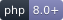
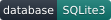

# Modo CMS

**English** | [Polski](README.pl.md)

[](https://modocms.top/)




**🌐 Live site:** <https://modocms.top/>

**Modo CMS** is a lightweight, fast and modular content management system (CMS) built on **PHP 8.x** and **SQLite3**. It is designed for developers who value a readable architecture based on simple procedural functions, no unnecessary object overhead, and full control over the code of templates and plugins.

---

## 📚 Documentation

| Document | English | Polski |
|---|---|---|
| Installation | [docs/en/installation.md](docs/en/installation.md) | [docs/pl/instalacja.md](docs/pl/instalacja.md) |
| Creating plugins (native Modo) | [docs/en/plugins.md](docs/en/plugins.md) | [docs/pl/pluginy.md](docs/pl/pluginy.md) |
| Creating GetSimple-style plugins | [docs/en/getsimple-plugins.md](docs/en/getsimple-plugins.md) | [docs/pl/wtyczki.md](docs/pl/wtyczki.md) |
| Theme functions (plain-language reference) | [docs/en/theme-functions.md](docs/en/theme-functions.md) | [docs/pl/funkcje-motywu.md](docs/pl/funkcje-motywu.md) |
| Hooks (actions & filters) | [docs/en/hooks.md](docs/en/hooks.md) | [docs/pl/hooki.md](docs/pl/hooki.md) |
| Page types | [docs/en/page-types.md](docs/en/page-types.md) | [docs/pl/typy-stron.md](docs/pl/typy-stron.md) |
| Examples | [docs/en/examples.md](docs/en/examples.md) | [docs/pl/przyklady.md](docs/pl/przyklady.md) |
| Theme editor styles | [docs/en/theme-editor-styles.md](docs/en/theme-editor-styles.md) | [docs/pl/styl-motywu-w-edytorze.md](docs/pl/styl-motywu-w-edytorze.md) |
| Changelog | [CHANGELOG.en.md](CHANGELOG.en.md) | [CHANGELOG.md](CHANGELOG.md) |

---

## 🚀 Main features

* **Simple architecture:** Minimalist, easy-to-remember template functions.
* **SQLite3 database:** No need to configure external database servers — the database is a single file, easy to migrate and back up.
* **Dynamic Theme Customizer:** Appearance configuration with live preview. Sections and fields (many types) are declared in `theme.json`, through plugin hooks (`modo_customize_register`) or created directly in the panel (GUI builder stored in the database).
* **Built-in Custom Fields:** Support for various field types (text, textarea, rich text / TinyMCE, galleries with columns, gap, lightbox and captions, number, checkbox, color, image).
* **Page types:** Create reusable content presets for pages and posts with default custom fields, available from the editor and exposed to themes via `get_page_type()` / `is_page_type()`.
* **Plugin architecture (Hooks):** A system of actions and filters that makes it easy to extend the admin panel and the frontend.
* **Content editor (no CDN):** classic WYSIWYG (TinyMCE 6.8.3) bundled locally. Toolbar presets, media library, grid builder and plugin buttons work out of the box.
* **CSS grids / frameworks (no CDN):** choose a popular grid system (Bootstrap, Bulma, Pico, UIkit, Foundation, Tailwind, a custom "Modo Grid" or Custom). The same bundled CSS is used on the frontend and in the content editor, so a grid laid out in the editor looks identical on the site.
* **Security:** Protection against SQL Injection (PDO Prepared Statements), CSRF, permission verification and output sanitisation.

---

## 🆕 What's new in 3.0.8

* **Theme Customizer without sidebar reloads:** the settings panel and the live preview are now separate documents. Changing a setting refreshes only the preview iframe, so the panel keeps its scroll position, expanded sections and focus.
* **Faster live CSS preview:** CSS variables are applied directly inside the preview document and re-applied after every preview refresh.
* **Predictable publish/reset:** publishing or resetting still reloads the whole editor so every field immediately shows the committed values.

---

## 🆕 What's new in 3.0.7

* **Thumbnail template helpers:** `post_thumbnail_image()` / `page_thumbnail_image()` and `post_image_srcset()` / `page_image_srcset()` use the selected featured image's generated thumbnails.
* **Phone photo orientation fixed:** EXIF Orientation is applied to WebP copies as well as thumbnails, so portrait 9:16 photos stay portrait.
* **Existing media corrected:** the force regeneration action rebuilds thumbnails and WebP copies; `webp_url()` falls back to the original when an old WebP has the wrong orientation.
* **Complete translations:** all missing EN/PL/DE/ES keys were filled and `tools/i18n-audit.php` now reports future gaps.

---

## 🆕 What's new in 3.0.6

* **Select all in the media picker:** multi-select mode now has a "Select all" checkbox that respects the current folder filter.
* **Bulk media editing:** update ALT text and captions, transform selected images (rotate, flip, resize, quality) and regenerate their thumbnails.
* **Force-regenerate all thumbnails:** Settings → Performance can rebuild every preview and gallery thumbnail for the whole library.
* **Automatic ALT/caption schema migration:** new `media` columns are added automatically on update.
* **Instant thumbnail rebuild after editing:** image edits regenerate all configured sizes, including gallery widths.

---

## 🆕 What's new in 3.0.5

* **Gallery preview in the admin panel:** gallery field items now use the system-generated thumbnails (`thumb.php`, 160 px) instead of loading full-size originals.
* **Subdirectory support:** `admin/thumb.php` now accepts image paths that include the installation's base subdirectory (e.g. `/cms/uploads/...`).
* **Safe fallback:** if a thumbnail cannot be generated, the preview falls back to the original image.
* **No database changes:** updating from 3.0.4 requires no migration.

---

## 🆕 What's new in 3.0.4

* **TinyMCE is now the only content editor:** the Editor.js block editor and its settings, assets and plugin bridge were removed. Legacy JSON content is converted to HTML automatically on the first admin request; `tools/migrate-editorjs.php` is available for CLI use.
* **Better grid editing:** dashed row/column guides in the editor, 10 px canvas padding, automatic `<p>` wrappers and normalisation so changing `h1 → p` no longer breaks the grid.
* **No horizontal scrollbar:** `box-sizing: border-box` on grid containers/columns and `overflow-x: hidden` in the editor canvas.
* **Dark mode fix:** the TinyMCE content canvas always stays white; only the toolbar and dialogs follow dark mode.

---

## 🆕 What's new in 3.0.3

* **Gallery thumbnails:** custom-field galleries and the Modo Gallery plugin now load thumbnails through `srcset`/`sizes` (480 and 960 px by default) instead of full-size images, while the lightbox still opens the original. Existing 240/320 px previews are reused immediately, so galleries benefit before a full backfill.
* **Gallery thumbnail settings:** *Settings → Performance → Gallery thumbnails* lets you enable or disable gallery thumbnails, toggle automatic generation, set the widths (default `480,960`) and quality (default `78`). The panel also shows the number of missing gallery thumbnails and a **Generate gallery thumbnails** button that processes only images used by galleries.
* **Large photos:** when an image exceeds GD's 20 MP limit, the ImageMagick CLI (`/usr/bin/convert`) is used automatically if available, so 6000×8000 photos also get thumbnails.
* **Diagnostics:** the backfill reports generated, skipped and failed files; the interface shows errors instead of a false success, and generation failures are written to the PHP error log.
* **Full URLs and subdirectories:** local paths such as `https://example.com/uploads/...` and subdirectory installs (`/cms/uploads/...`) are recognised correctly.
* **Media library tools:** bulk deletion of selected files and folder contents, a media lightbox with zoom and navigation, and a browser image editor with rotate, flip, crop, save-as-copy and overwrite.
* **One-click updater:** *Settings → System* checks the latest public release through the GitHub API (with a 12-hour cache and a manual refresh), downloads it over HTTPS, verifies the SHA-256 digest when published, backs up every replaced file and the database, and installs with maintenance mode plus automatic rollback. When the anonymous API limit is reached, the public releases feed is used; an optional GitHub token raises the limit. `data/`, `uploads/`, `modoconfig.php` and `install.php` are never touched.
* **Version source:** `core/Version.php` is now the single source of truth for the installed version.
* **Lightbox fix:** the `.modo-gallery` container is no longer treated as a theme lightbox trigger, so on “Realizacje” posts only the GLightbox from the custom field handles gallery images.
* **Cookie Consent 1.0.1:** the banner no longer locks page scrolling in the `bar`, `card`, `bottom-left` and `bottom-right` layouts; only the full-screen modal locks scrolling and its content remains scrollable.
* **Safe fallback:** without GD, Imagick or the ImageMagick CLI, galleries use the original images and nothing breaks. The panel warns when the backend is missing or `uploads/thumbs` is not writable.

---

## 🆕 What's new in 3.0.2

* **Optional theme styles in the content editor:** a theme can now ship `themes/<theme>/assets/css/editor.css` to style the TinyMCE canvas only. The file is detected automatically — no new setting, no fallback to `style.css`, and no frontend changes. Optional `editor.body_class` and `editor.content_style` metadata can be added to `theme.json`. See [docs/en/theme-editor-styles.md](docs/en/theme-editor-styles.md).

---

## 🆕 What's new in 3.0.1

* **Template settings panel:** settings sections are collapsed by default and expanded ones stay open across preview reloads; typing in text fields no longer refreshes the page (the preview updates once editing is committed), and the draft is saved before every reload. **Publish** and **Reset** no longer recreate the draft.

---

## 🆕 What's new in 3.0.0

* **Page types:** reusable presets for static pages and blog posts with default custom fields — a dedicated admin screen, `get_page_type()` / `is_page_type()` theme functions, API support and revision history that keeps the document type.
* **Media library folders:** one-level physical folders inside `uploads/` with upload to a selected folder, single and bulk moves, renaming, breadcrumb filtering and automatic URL updates in pages, posts, snippets, settings, theme data, revisions and plugin data.
* **Media and gallery thumbnails:** lightweight 80/160/240 px admin previews plus configurable 480/960 px gallery images generated on upload, image edit and gallery save; a backfill tool, `srcset`/`sizes`, lazy loading and lightboxes that still open the original file.
* **Richer custom fields:** rich text (TinyMCE) and galleries with columns, gap, lightbox and captions.
* **Forms 1.2.0:** HTML e-mail notifications enabled by default, recipient fallback chain, optional Reply-To set to the sender and a redesigned message template.
* **Automatic slugs:** a duplicate slug no longer blocks saving — `-1`, `-2`, etc. are appended per language in the editor, quick draft, API and revision restore.

The full list is in [CHANGELOG.md](CHANGELOG.md).

---

## 🏷️ Post categories (blog)

Blog posts can be grouped into **flat categories** (no hierarchy). Support covers the panel, the theme and SEO:

* **Panel:** *Categories* (`admin/categories.php`, capability `manage_pages`) — add, edit (name, slug, description) and delete categories together with the number of assigned posts. The slug is generated automatically from the name when the field is left empty.
* **Assignment:** in the post editor (`page-edit.php`) the sidebar contains a **Categories** section (visible only for the *Post* type) — a list of checkboxes with a search filter. Deleting a category automatically detaches it from all posts (`page_categories` with `ON DELETE CASCADE`).
* **Frontend (theme functions):**
  * `get_post_categories(?int $pageId = null): array` — array of the post's categories (`id`, `name`, `slug`, `description`).
  * `has_categories(?int $pageId = null): bool` — whether the post has any categories assigned.
  * `post_categories(?int $pageId = null, string $cssClass = 'post-categories', bool $echo = true)` — links to category archives (class `category-badge`).
* **Archive:** `/{blog-page-slug}/category/{slug}` (e.g. `/blog/category/technology`) with pagination (`?page=N`) and the heading `Category: {name}`. The description in `<meta name="description">` comes from the category's *Description* field, otherwise it is generated automatically. An unknown slug returns 404.
* **Sitemap:** category archives are added to `sitemap.xml` (priority `0.5`), just like tag archives.

---

## ⚙️ System requirements

* PHP **8.0** or newer
* PHP extensions: **pdo_sqlite**, **sqlite3**, **mbstring**
* Web server: **Apache** (with `mod_rewrite` and `.htaccess` support) or **Nginx**
* The built-in updater requires the **ZipArchive** PHP extension and outbound HTTPS access (cURL or `allow_url_fopen`).
* Thumbnail backend (optional but recommended): **GD** or **Imagick** PHP extension, or the ImageMagick CLI (`convert`). Without any of them, media previews and galleries fall back to the original images.
* `uploads/` must be writable by PHP, including `uploads/thumbs/` for generated thumbnails.

---

## 🌍 Supported installation locations

Modo CMS works both in the **domain root** and in a **subdirectory (subfolder)** — with no manual configuration changes:

* root: `https://example.com/`
* subfolder: `https://example.com/modocms/`

The base path is detected dynamically (based on `SCRIPT_NAME` / file location via `Router::getBaseSubdirectory()`), and the `.htaccess` file **does not contain `RewriteBase`** — Apache calculates the base from the directory in which the file resides. As a result, the same files work in both cases.

> 🔒 **Do not add `RewriteBase /name/`** to `.htaccess` — this would break an installation in the root. Leave the file without that directive.

---

## 📦 Installation in the root directory

1. Copy or clone the project contents **directly** into the web server root:
   ```bash
   cd /var/www/html
   git clone <repository-url> .
   ```
2. Grant write permissions to the `data/` and `uploads/` directories:
   ```bash
   chmod -R 775 data uploads
   ```
3. Open `https://example.com/install.php` in your browser and go through the installation wizard.
4. After installation, delete the `install.php` file.

Addresses after installation: homepage `https://example.com/`, panel `https://example.com/admin/`.

---

## 📁 Installation in a subdirectory (subfolder)

1. Copy or clone the project into a subdirectory:
   ```bash
   cd /var/www/html
   mkdir modocms
   git clone <repository-url> modocms
   # or simply copy the files to: /var/www/html/modocms
   ```
2. Grant write permissions to the `data/` and `uploads/` directories:
   ```bash
   chmod -R 775 modocms/data modocms/uploads
   ```
3. Open `https://example.com/modocms/install.php` and go through the wizard.

Addresses after installation: homepage `https://example.com/modocms/`, panel `https://example.com/modocms/admin/`. Nothing needs to be changed — `.htaccess` and the runtime will detect the subdirectory automatically.

---

## 🛠️ Web server configuration

### Apache

The `.htaccess` file (included in the project) handles rewriting traffic to the front controller (`index.php`) both in the root and in a subfolder. Make sure the vhost has overrides enabled and that the `mod_rewrite` and `mod_headers` modules are active:

```apache
<Directory /var/www/html>
    AllowOverride All
    Require all granted
</Directory>
```

```bash
# Debian/Ubuntu
sudo a2enmod rewrite headers
sudo systemctl restart apache2
```

### Nginx

Nginx **does not read** `.htaccess` — an appropriate `server` block is required. Example for an installation in the **root**:

```nginx
server {
    listen 80;
    server_name example.com;
    root /var/www/html;
    index index.php;

    location / {
        try_files $uri $uri/ /index.php?$query_string;
    }

    location ~ \.php$ {
        include fastcgi_params;
        fastcgi_pass unix:/run/php/php8-fpm.sock;   # adjust to your PHP-FPM version
        fastcgi_param SCRIPT_FILENAME $document_root$fastcgi_script_name;
    }

    # Block access to internal directories
    location ~* ^/(data|core)/ { deny all; }
}
```

For an installation in a **subdirectory**, change the routing rule:

```nginx
    location /modocms/ {
        try_files $uri $uri/ /modocms/index.php?$query_string;
    }
```

### PHP — built-in server (development only)

Root directory:
```bash
php -S localhost:8000 -t /var/www/html
```

Subdirectory:
```bash
cd /var/www/html
php -S localhost:8000
# open: http://localhost:8000/modocms/
```

> The PHP built-in server does not read `.htaccess`. For "clean" URLs (without `index.php` in the address), use Apache or Nginx; in simple development you can also include your own router script (`php -S localhost:8000 router.php`).

---

## 🔐 Permissions and security

* The `data/` and `uploads/` directories must be writable by the web server user (e.g. `www-data`).
* The `.htaccess` files in `data/` and `uploads/` block direct HTTP access to the database and executable files.
* The engine blocks (in `.htaccess`) direct access to `.sqlite`, `.db`, `.log`, `.ini`, `.json` files and to the `data/` and `languages/` directories.

---

## 🎨 Theme Customizer

The backend panel **Appearance → Customizer** (`/admin/customize.php`) is used **only to manage settings** (the section and field builder stored in the database). It contains no template preview or value editing — those happen on the frontend.

Value editing (with live preview) is available directly on the frontend: the **"Edit template settings"** link in the admin bar opens a panel sliding in from the left with the theme settings on the **live site**. The panel and the preview live in separate documents — the site is rendered in an iframe next to the sidebar — so refreshing the preview during editing never rebuilds the panel: its scroll position, expanded sections and focus stay intact. Controls bound to a CSS variable (`css_var`) update the appearance instantly; the others refresh only the preview iframe with the draft applied once editing is finished (when leaving a text field or toggling a switch), so typing never triggers a refresh. Settings sections are collapsed by default. Changes are saved as a draft, and the **Publish** button commits them to the database (publishing and resetting intentionally reload the whole editor so the fields show the committed values). The `Core\CustomizerPanel` class handles the shell and is hooked into `theme-header`/`theme-footer` for the preview, so it works in every theme.

### Field types

`text`, `textarea`, `code`, `number`, `range` (slider), `checkbox`/`toggle`, `select`, `radio`, `color`, `image`, `url`, `email`, plus the layout elements `heading` and `hr`.

### Sources of settings definitions

The schema is merged from three sources (a later one overrides an earlier one with the same `id`):

1. **Theme** — the `customize` block in `themes/<theme>/theme.json`.
2. **Plugins** — the `modo_customize_register` hook (registering via `Customizer::registerSection()` / `registerControl()`), optionally the `modo_customize_schema` filter.
3. **GUI builder** — sections/fields created in the "Manage settings" tab (the `customize_schema` table).

#### Example in `theme.json`

```json
"customize": {
  "sections": [
    {
      "id": "branding",
      "title": "Branding",
      "priority": 10,
      "controls": [
        {
          "id": "modo_primary_color",
          "type": "color",
          "label": "Accent colour",
          "default": "#0d6efd",
          "css_var": "modo-primary"
        },
        { "id": "modo_footer_text", "type": "text", "label": "Footer text", "default": "Modo CMS" }
      ]
    }
  ]
}
```

#### Plugin example

```php
use Core\Hooks;
use Core\Customizer;

Hooks::addAction('modo_customize_register', function () {
    Customizer::registerSection(['id' => 'plugin', 'title' => 'Plugin']);
    Customizer::registerControl([
        'id' => 'plugin_show_banner',
        'type' => 'checkbox',
        'label' => 'Show banner',
        'section' => 'plugin',
        'default' => '1',
    ]);
});
```

### Reading values in a theme

```php
<?php the_theme_mod('modo_footer_text'); // prints the value, escaped ?>
<?php $v = get_theme_mod('modo_footer_text', 'Default text'); // returns the value ?>
```

Controls with a `css_var` key are automatically emitted in `<head>` as `:root` CSS variables (the `customizer_css()` function, called from `theme_head()`), giving instant preview of colour and size changes without reloading the page. Values are published in the `theme_mods` table, and the preview draft is kept in the logged-in administrator's session.

---

## ✍️ Content editor (TinyMCE)

Pages, posts and snippets use the bundled **TinyMCE 6.8.3** visual editor. Everything ships locally — no CDN and no build step.

* Content is stored as HTML in the `content` field.
* Toolbar presets and a custom toolbar string are configured in **Settings → "Content" tab → Content Editor**.
* Plugins add their toolbar buttons through `tinymce.init` patches: **Gallery / Form / Carousel** insert their shortcodes at the cursor.
* Images are uploaded via `admin/upload.php`, and the media-library button opens the existing modal.
* A theme can ship `themes/<theme>/assets/css/editor.css` to style the editor canvas only; see [docs/en/theme-editor-styles.md](docs/en/theme-editor-styles.md).
* Legacy content saved by the removed Editor.js block editor is converted to HTML automatically on the first admin request after the update.

---

## 🧮 CSS grids / frameworks (no CDN)

Modo CMS can load a popular grid system **locally (no CDN)** and use it both on the frontend and in the content editor — so a grid laid out in TinyMCE looks exactly the same on the published page.

### Choosing a framework

In the panel **Settings → "Content" tab → CSS Grid / Framework** you choose:

* **Grid framework** — `None`, `Bootstrap 5`, `Bulma`, `Pico CSS`, `UIkit`, `Foundation`, `Tailwind CSS`, `Modo Grid` (a built-in custom grid) or `Custom`.
* **Load the grid CSS on the frontend** — whether to include the grid sheet on the site.
* **Load the grid CSS in the content editor** — whether to include the same sheet in the editor canvas.
* **Custom grid CSS (optional)** — extra CSS appended after the chosen framework (useful with `Custom`).

All sheets are bundled in the repository under `assets/grids/<framework>/grid.css` — **no assets are fetched from a CDN**.

### Frontend

When a framework is selected and frontend injection is enabled, `Core\CssFramework` (hooked into `theme_head`) outputs a `<link rel="stylesheet">` in `<head>`. It works automatically in every theme that calls `theme_head()`. A theme can also read the active framework via `active_grid()` / `grid_css_urls()`.

### Content editor

The same sheet is passed to TinyMCE as `content_css`, and additionally the **"Insert grid / columns"** button (token `modo_grid`) on the toolbar opens a builder that generates markup **correct for the chosen framework**:

| Framework  | Row                | Column                           |
|------------|--------------------|----------------------------------|
| Bootstrap  | `.row`             | `.col-md-6`                      |
| Bulma      | `.columns`         | `.column.is-6`                   |
| Pico       | `.grid`            | `<div>` (auto)                   |
| UIkit      | `.uk-grid`         | `.uk-child-width-1-2@s`          |
| Foundation | `.grid-x`          | `.cell.medium-6`                 |
| Tailwind   | `.grid.grid-cols-2`| `<div>`                          |
| Modo Grid  | `.modo-grid`       | `.modo-col-md-6`                 |
| Custom     | `.grid-row`        | `.grid-col`                      |

The builder lets you choose the number of columns, a responsive breakpoint, an optional container and column content (one line = one column). The scripts handling the button: `admin/assets/js/grid-editor.js` + `window.MODO_GRID` (server-provided configuration). The server-side HTML generation used while converting legacy grid blocks is done by `CssFramework::gridMarkup()`.

In the editor the grid is visible through dashed guides: the row gets a blue outline and columns an amber one (editor canvas only, never on the frontend). Every column's content is wrapped in `<p>` automatically — including existing grids when the editor opens — so changing a block format (e.g. `h1 → p`) no longer turns the column `<div>` into a heading and destroys the grid structure. The TinyMCE canvas also has 10 px of inner padding.

### Changing the framework

Changing the setting is immediate — it only modifies the loaded sheet. To avoid double loading, when the theme already supplies a given framework (e.g. Bootstrap from a CDN), leave `None`.

---

## 🧭 Frontend Admin Bar

Logged-in users see an admin bar on the site (frontend) similar to WordPress. It is rendered by the `Core\AdminBar` class (hooked into `theme-header`/`theme-footer`), so it works automatically in every theme that calls `theme_head()` and `theme_footer()`.

Shortcuts: **Dashboard**, **+ New** *(manage_pages)*, **Edit** (the current page/post), **Edit template settings** *(manage_settings)* — opens the frontend Customizer sidebar on the current page, the user profile and **Log out**. The bar pushes the page content down (`margin-top`) by default and can be collapsed (state saved in `localStorage`). It is not shown in the admin panel or for logged-out users/guests.

---

## 🧩 Plugins and GetSimple-style plugins

Modo CMS supports **two ways** of extending the system:

1. **Native Modo plugins** — based on the `Core\Hooks` class (`Hooks::addAction()` / `Hooks::addFilter()`). Loaded automatically from `plugins/`. See [docs/en/plugins.md](docs/en/plugins.md).
2. **GetSimple-style plugins** — based on the compatibility layer (`register_plugin()`, `add_action()`, `createSideMenu()`, `i18n_merge()`). Convenient when porting existing GetSimple plugins. See [docs/en/getsimple-plugins.md](docs/en/getsimple-plugins.md).

Both types are activated in the panel: **Plugins** (`/admin/plugins.php`), which toggles the `is_active` flag in the `plugins` table.

A minimal example of a native plugin (`plugins/hello-world.php`):

```php
<?php
/**
 * Plugin Name: Hello World Filter
 * Description: Demonstrates hooks and content filtration in Modo CMS.
 */
use Core\Hooks;

Hooks::addFilter('the_content', function (string $content) {
    return $content . '<p>Powered by Modo CMS</p>';
});
```

The bundled plugins are: **Modo Form**, **Modo Gallery**, **Modo Carousel** and **Cookie Consent**.

---

## 📧 Sending e-mail (Mail / SMTP)

The global method of sending messages is configured in **System settings → E-mail**. Two transports are available:

- **PHP `mail()`** – uses the `mail()` function (requires a working MTA such as Postfix/sendmail on the server).
- **SMTP (PHPMailer)** – sending via an SMTP server using the bundled [PHPMailer](https://github.com/PHPMailer/PHPMailer) library (`core/vendor/PHPMailer`). Recommended for reliable deliverability. Supports TLS/SSL, authentication and a configurable port.

Available options: sender address and name, SMTP host/port, encryption (none / TLS / SSL), authentication (user + password) and connection timeout.

All outgoing messages go through the `Core\Mailer` class (`core/Mailer.php`), so **plugins (e.g. Modo Form) automatically use these settings**. Modo Form calls `\Core\Mailer::send()` for submission notifications; a custom "Sender e-mail" set in the plugin overrides the global sender, and when it is empty the global address is used.

Usage in code:

```php
\Core\Mailer::send(
    ['recipient@example.com' => 'Recipient'],
    'Subject',
    'Message body',
    ['from_email' => 'shop@example.com', 'html' => false]
);
```

---

## 🤝 Contributing

The rules for submitting changes and reporting issues are described in [CONTRIBUTING.md](CONTRIBUTING.md) (Polish and English).

---

## 📝 License

This project is distributed under the **MIT License**. See the [LICENSE](LICENSE) file.

Copyright (c) 2026 Modo CMS.
