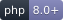
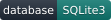

# Modo CMS

[English](README.md) | **Polski**

[](https://multicolor-rgb.github.io/ModoCMS/)




**🌐 Strona na żywo:** <https://multicolor-rgb.github.io/ModoCMS/>

**Modo CMS** to lekki, szybki i modułowy system zarządzania treścią (CMS) oparty na **PHP 8.x** oraz bazie danych **SQLite3**. Zaprojektowany z myślą o programistach ceniących czytelną architekturę opartą na prostych funkcjach proceduralnych, brak zbędnego narzutu obiektowego oraz pełną kontrolę nad kodem szablonów i wtyczek.

---

## 📚 Dokumentacja

| Dokument | English | Polski |
|---|---|---|
| Instalacja | [docs/en/installation.md](docs/en/installation.md) | [docs/pl/instalacja.md](docs/pl/instalacja.md) |
| Tworzenie pluginów (natywne Modo) | [docs/en/plugins.md](docs/en/plugins.md) | [docs/pl/pluginy.md](docs/pl/pluginy.md) |
| Tworzenie wtyczek w stylu GetSimple | [docs/en/getsimple-plugins.md](docs/en/getsimple-plugins.md) | [docs/pl/wtyczki.md](docs/pl/wtyczki.md) |
| Funkcje motywu (opis dla laika) | [docs/en/theme-functions.md](docs/en/theme-functions.md) | [docs/pl/funkcje-motywu.md](docs/pl/funkcje-motywu.md) |
| Hooki (akcje i filtry) | [docs/en/hooks.md](docs/en/hooks.md) | [docs/pl/hooki.md](docs/pl/hooki.md) |
| Przykłady | [docs/en/examples.md](docs/en/examples.md) | [docs/pl/przyklady.md](docs/pl/przyklady.md) |

---

## 🚀 Główne cechy

* **Prosta architektura:** Minimalistyczne, łatwe do zapamiętania funkcje szablonu.
* **Baza SQLite3:** Brak konieczności konfiguracji zewnętrznych serwerów bazodanowych – baza w jednym pliku, łatwa do migracji i kopii zapasowych.
* **Dynamiczny Theme Customizer:** Konfiguracja wyglądu z podglądem na żywo. Sekcje i pola (wiele typów) deklaruje się w `theme.json`, przez hooki wtyczek (`modo_customize_register`) lub tworzy bezpośrednio w panelu (builder GUI zapisywany w bazie).
* **Wbudowane pola niestandardowe (Custom Fields):** Obsługa różnych typów pól (tekst, textarea, liczba, checkbox, kolor, obrazek).
* **Architektura wtyczek (Hooks):** System akcji i filtrów pozwalający na łatwą rozbudowę panelu admina oraz frontendu.
* **Wybór edytora treści (bez CDN):** klasyczny WYSIWYG (TinyMCE 6.8.3) albo edytor blokowy (Editor.js 2.31.7) — oba dołączone lokalnie. Treść zachowuje format, w jakim została zapisana, więc edytor można zmienić w każdej chwili bez utraty istniejących stron.
* **Siatki / frameworki CSS (bez CDN):** Wybór popularnego systemu siatek (Bootstrap, Bulma, Pico, UIkit, Foundation, Tailwind, własny „Modo Grid” lub Custom). Ten sam bundled CSS trafia na frontend i do edytora treści, więc siatka ułożona w edytorze wygląda identycznie na stronie.
* **Bezpieczeństwo:** Ochrona przed SQL Injection (PDO Prepared Statements), CSRF, weryfikacja uprawnień i sanityzacja danych wyjściowych.

---

## 🏷️ Kategorie wpisów (blog)

Wpisy blogowe można grupować w **płaskie kategorie** (bez hierarchii). Obsługa obejmuje panel, motyw i SEO:

* **Panel:** *Kategorie* (`admin/categories.php`, uprawnienie `manage_pages`) — dodawanie, edycja (nazwa, slug, opis) i usuwanie kategorii wraz z liczbą przypisanych wpisów. Slug generuje się automatycznie z nazwy, gdy pole pozostanie puste.
* **Przypisywanie:** w edytorze wpisu (`page-edit.php`) w kolumnie bocznej znajduje się sekcja **Kategorie** (widoczna tylko dla typu *Wpis*) — lista checkboxów z filtrem wyszukiwania. Usunięcie kategorii automatycznie odłącza ją od wszystkich wpisów (`page_categories` z `ON DELETE CASCADE`).
* **Frontend (funkcje motywu):**
  * `get_post_categories(?int $pageId = null): array` — tablica kategorii wpisu (`id`, `name`, `slug`, `description`).
  * `has_categories(?int $pageId = null): bool` — czy wpis ma przypisane kategorie.
  * `post_categories(?int $pageId = null, string $cssClass = 'post-categories', bool $echo = true)` — linki do archiwów kategorii (klasa `category-badge`).
* **Archiwum:** `/{slug-strony-bloga}/category/{slug}` (np. `/blog/category/technology`) z paginacją (`?page=N`) i nagłówkiem `Kategoria: {nazwa}`. Opis w `<meta name="description">` pochodzi z pola *Opis* kategorii, w razie braku jest generowany automatycznie. Nieznany slug zwraca 404.
* **Sitemap:** archiwa kategorii trafiają do `sitemap.xml` (priorytet `0.5`), analogicznie do archiwów tagów.

---

## ⚙️ Wymagania systemowe

* PHP **8.0** lub nowszy
* Rozszerzenia PHP: **pdo_sqlite**, **sqlite3**, **mbstring**
* Serwer WWW: **Apache** (z `mod_rewrite` i obsługą `.htaccess`) lub **Nginx**

---

## 🌍 Obsługiwane lokalizacje instalacji

Modo CMS działa zarówno w **katalogu głównym domeny**, jak i w **podkatalogu (subfolderze)** — bez ręcznej zmiany konfiguracji:

* katalog główny: `https://example.com/`
* podkatalog: `https://example.com/modocms/`

Bazowa ścieżka jest wykrywana dynamicznie (na podstawie `SCRIPT_NAME` / lokalizacji plików przez `Router::getBaseSubdirectory()`), a plik `.htaccess` **nie zawiera `RewriteBase`** — Apache sam wylicza bazę z katalogu, w którym leży plik. Dzięki temu te same pliki działają w obu przypadkach.

> 🔒 **Nie dodawaj `RewriteBase /nazwa/`** do `.htaccess` — to zepsułoby instalację w katalogu głównym. Pozostaw plik bez tej dyrektywy.

---

## 📦 Instalacja w katalogu głównym (Root)

1. Skopiuj lub sklonuj zawartość projektu **bezpośrednio** do katalogu głównego serwera WWW:
   ```bash
   cd /var/www/html
   git clone <adres-repozytorium> .
   ```
2. Nadaj prawa zapisu katalogom `data/` i `uploads/`:
   ```bash
   chmod -R 775 data uploads
   ```
3. Otwórz w przeglądarce `https://example.com/install.php` i przejdź przez kreator instalacji.
4. Po zakończeniu instalacji usuń plik `install.php`.

Adresy po instalacji: strona główna `https://example.com/`, panel `https://example.com/admin/`.

---

## 📁 Instalacja w podkatalogu (Subfolder)

1. Skopiuj lub sklonuj projekt do podkatalogu:
   ```bash
   cd /var/www/html
   mkdir modocms
   git clone <adres-repozytorium> modocms
   # lub po prostu skopiuj pliki do: /var/www/html/modocms
   ```
2. Nadaj prawa zapisu katalogom `data/` i `uploads/`:
   ```bash
   chmod -R 775 modocms/data modocms/uploads
   ```
3. Otwórz `https://example.com/modocms/install.php` i przejdź przez kreator.

Adresy po instalacji: strona główna `https://example.com/modocms/`, panel `https://example.com/modocms/admin/`. Nie trzeba nic zmieniać — `.htaccess` i runtime wykryją podkatalog automatycznie.

---

## 🛠️ Konfiguracja serwera WWW

### Apache

Plik `.htaccess` (dołączony do projektu) obsługuje przepisywanie ruchu na front controller (`index.php`) zarówno w root, jak i w subfolderze. Upewnij się, że vhost ma włączone nadpisywanie oraz że aktywne są moduły `mod_rewrite` i `mod_headers`:

```apache
<Directory /var/www/html>
    AllowOverride All
    Require all granted
</Directory>
```

```bash
# Debian/Ubuntu
sudo a2enmod rewrite headers
sudo systemctl restart apache2
```

### Nginx

Nginx **nie czyta** `.htaccess` — potrzebny jest odpowiedni blok `server`. Przykład dla instalacji w **katalogu głównym**:

```nginx
server {
    listen 80;
    server_name example.com;
    root /var/www/html;
    index index.php;

    location / {
        try_files $uri $uri/ /index.php?$query_string;
    }

    location ~ \.php$ {
        include fastcgi_params;
        fastcgi_pass unix:/run/php/php8-fpm.sock;   # dostosuj do swojej wersji PHP-FPM
        fastcgi_param SCRIPT_FILENAME $document_root$fastcgi_script_name;
    }

    # Zablokuj dostęp do katalogów wewnętrznych
    location ~* ^/(data|core)/ { deny all; }
}
```

Dla instalacji w **podkatalogu** zmień regułę routingu:

```nginx
    location /modocms/ {
        try_files $uri $uri/ /modocms/index.php?$query_string;
    }
```

### PHP – wbudowany serwer (tylko do developmentu)

Katalog główny:
```bash
php -S localhost:8000 -t /var/www/html
```

Podkatalog:
```bash
cd /var/www/html
php -S localhost:8000
# otwórz: http://localhost:8000/modocms/
```

> Wbudowany serwer PHP nie odczytuje `.htaccess`. Dla „czystych” URL-i (bez `index.php` w adresie) użyj Apache lub Nginx; w prostym dev-ie można też dołączyć własny router-skrypt (`php -S localhost:8000 router.php`).

---

## 🔐 Uprawnienia i bezpieczeństwo

* Katalogi `data/` oraz `uploads/` muszą być zapisywalne przez użytkownika serwera WWW (np. `www-data`).
* Pliki `.htaccess` w `data/` i `uploads/` blokują bezpośredni dostęp HTTP do bazy i plików wykonywalnych.
* Silnik blokuje (w `.htaccess`) bezpośredni dostęp do plików `.sqlite`, `.db`, `.log`, `.ini`, `.json` oraz do katalogów `data/` i `languages/`.

---

## 🎨 Theme Customizer

Panel w backendzie: **Wygląd → Customizer** (`/admin/customize.php`) służy **wyłącznie do zarządzania ustawieniami** (builder sekcji i pól zapisywany w bazie). Nie zawiera podglądu szablonu ani edycji wartości — te czynności wykonuje się na froncie.

Edycja wartości (z podglądem na żywo) dostępna jest bezpośrednio na froncie: link **„Edytuj ustawienia szablonu”** w pasku administratora otwiera wysuwaną z prawej strony sekcję z ustawieniami motywu na **żywej stronie** — bez `iframe`, podglądem jest sama witryna. Kontrolki powiązane ze zmienną CSS (`css_var`) aktualizują wygląd natychmiast, pozostałe odświeżają stronę z nałożonym szkicem. Zmiany zapisują się jako szkic, a przycisk **Opublikuj** utrwala je w bazie. Klasa `Core\CustomizerPanel` jest wpięta w `theme-header`/`theme-footer`, więc działa w każdym motywie.

### Typy pól

`text`, `textarea`, `code`, `number`, `range` (suwak), `checkbox`/`toggle`, `select`, `radio`, `color`, `image`, `url`, `email` oraz elementy układu `heading` i `hr`.

### Źródła definicji ustawień

Schemat jest scalany z trzech źródeł (późniejsze nadpisuje wcześniejsze przy tym samym `id`):

1. **Motyw** — blok `customize` w `themes/<motyw>/theme.json`.
2. **Wtyczki** — hook `modo_customize_register` (rejestracja przez `Customizer::registerSection()` / `registerControl()`), opcjonalnie filtr `modo_customize_schema`.
3. **Builder GUI** — sekcje/pola utworzone w zakładce „Zarządzaj ustawieniami” (tabela `customize_schema`).

#### Przykład w `theme.json`

```json
"customize": {
  "sections": [
    {
      "id": "branding",
      "title": "Branding",
      "priority": 10,
      "controls": [
        {
          "id": "modo_primary_color",
          "type": "color",
          "label": "Kolor akcentu",
          "default": "#0d6efd",
          "css_var": "modo-primary"
        },
        { "id": "modo_footer_text", "type": "text", "label": "Tekst w stopce", "default": "Modo CMS" }
      ]
    }
  ]
}
```

#### Przykład wtyczki

```php
use Core\Hooks;
use Core\Customizer;

Hooks::addAction('modo_customize_register', function () {
    Customizer::registerSection(['id' => 'plugin', 'title' => 'Wtyczka']);
    Customizer::registerControl([
        'id' => 'plugin_show_banner',
        'type' => 'checkbox',
        'label' => 'Pokaż banner',
        'section' => 'plugin',
        'default' => '1',
    ]);
});
```

### Odczyt wartości w motywie

```php
<?php the_theme_mod('modo_footer_text'); // wypisuje wartość z escapowaniem ?>
<?php $v = get_theme_mod('modo_footer_text', 'Domyślny tekst'); // zwraca wartość ?>
```

Pola z kluczem `css_var` są automatycznie wypisywane w `<head>` jako zmienne CSS `:root` (funkcja `customizer_css()`, wywoływana w `theme_head()`), co daje natychmiastowy podgląd zmian kolorów i rozmiarów bez przeładowania strony. Wartości publikowane są w tabeli `theme_mods`, a szkic podglądu trzymany jest w sesji zalogowanego administratora.

---

## ✍️ Wybór edytora treści (TinyMCE / Editor.js)

W panelu **Ustawienia → zakładka „Treści” → Content Editor** wybierasz edytor używany dla stron, wpisów i snippetów:

* **Classic (TinyMCE, WYSIWYG)** — domyślny, klasyczny edytor wizualny (TinyMCE 6.8.3, dołączony lokalnie).
* **Blocks (Editor.js)** — edytor blokowy (Editor.js 2.31.7) z zestawem narzędzi dołączonym lokalnie w `admin/assets/vendor/editorjs/`.

### Jak to działa

* Treść zapisywana jest w polu `content` w formacie, w którym została napisana: HTML (TinyMCE) albo JSON dokumentu Editor.js. **Zmiana edytora nie niszczy istniejących treści** — oba formaty mogą współistnieć na jednej instalacji.
* Dokumenty blokowe są zamieniane na HTML przy wyświetlaniu (`Core\EditorJs::render()`, filtr `the_content` z priorytetem 1 — przed rozwijaniem snippetów i shortcode'ów wtyczek).
* Strona zapisana jako HTML otwarta w edytorze blokowym jest automatycznie konwertowana do bloków (nieznany markup trafia do bloku „Raw HTML”, więc nic nie ginie).
* `post_excerpt()` oraz tagi `content_to_text()` / `content_excerpt()` zwracają czysty tekst niezależnie od użytego edytora.

### Dostępne bloki

Nagłówek, akapit, lista, lista kontrolna, cytat, separator, tabela, obraz, surowy HTML, krótki kod (shortcode) oraz narzędzia inline: wyróżnienie i kod w linii. Dodatkowo do włączenia: **ostrzeżenie**, **kod**, **osadzenie (embed)** i kreator **„Wstaw siatkę / kolumny”**. Zestaw wybiera się checkboxami w Ustawieniach — odznaczenie bloku tylko ukrywa go w edytorze (już zapisane bloki nadal są renderowane na stronie).

### Wtyczki i siatki

* Wtyczki rejestrują przyciski przez mostek `window.ModoEditor.registerButton()` (`admin/assets/js/editor-bridge.js`), dzięki czemu „Gallery / Form / Carousel” działają w obu edytorach. W TinyMCE pozostaje dotychczasowy mechanizm — zero regresji.
* Kreator siatki w Editor.js używa tego samego kodu co przycisk TinyMCE (`window.ModoGrid` w `grid-editor.js`), więc markup jest identyczny z tabelą poniżej. Arkusz CSS siatki jest zawężany do kanwy edytora (`CssFramework::editorScopedCss()`), bo Editor.js renderuje inline (bez iframe).
* Obrazy wgrywane są przez `admin/upload.php`, a przycisk biblioteki mediów korzysta z istniejącego modala.

### Język interfejsu edytora (i18n)

Edytor blokowy nie ma własnego przełącznika języka — **korzysta z języka panelu administratora** (Profil → „Admin Panel Language”, globalna wartość `admin_language`).

* Słownik interfejsu Editor.js buduje `Core\EditorJs::i18n()` (`core/EditorJs.php`): metoda `messages()` to kopia domyślnego słownika z `editorjs.umd.js` (nazwy narzędzi, menu bloku, popovery, `tools.<id>` dla narzędzi), a `translateTree()` przepuszcza każdy tekst przez `__()`. Kierunek tekstu (`i18n.direction`) ustawia `direction()` — dla `ar, fa, he, ur…` zwraca `rtl`.
* Tłumaczenia tekstów edytora są w tych samych plikach co reszta panelu: `languages/{pl,en,de,es}.json`. **Kluczem jest angielski tekst źródłowy** (np. `"Click to tune": "Kliknij, aby ustawić"`), a `languages/en.json` mapuje klucz na samego siebie. Pusty lub brakujący wpis nigdy nie wygasza etykiety — `__()` schodzi do `en.json`, a gdy i tam go nie ma, Editor.js pokazuje angielski tekst źródłowy.
* Wartości, które bundle czytają wyłącznie z `config` (placeholdery pól, podpis obrazu), zwraca `Core\EditorJs::toolConfig()` — słownik ich nie obsłuży. Komunikaty wstawiane przez bootstrap (`editorjs-init.js`) są w `clientConfig()['labels']`.

**Dodanie nowego narzędzia:** dopisz bundle do rejestru `EditorJs::TOOLS` (etykieta → tłumaczenie klucza), a jego własne teksty do `messages()` w namespace `'tools.' + id` (nazwę namespace wyznacza identyfikator narzędzia w rejestrze — tak samo robi Editor.js). Wszystkie klucze dodaj do `languages/*.json`. Blok `embed` ma w rejestrze `'toolbox' => false`, bo `embed.umd.js` 2.8.0 nie eksportuje `static get toolbox()` — `admin/assets/js/editorjs-init.js` opakowuje wtedy klasę i dokłada tłumaczony tytuł oraz ikonę, dzięki czemu blok da się wstawić z menu „+”.

**Znane ograniczenie:** przyciski *Confirm* / *Cancel* w popoverach są zaszyte w kodzie bundle'a Editor.js (nie przechodzą przez `api.i18n.t()`), więc pozostają angielskie — ich zmianę wymusiłaby edycja samego pliku `editorjs.umd.js`.

### Licencje

Wszystkie bundle Editor.js (MIT) są dołączone lokalnie — **żadne zapytania nie są wysyłane do CDN**. Teksty licencji znajdują się w `admin/assets/vendor/editorjs/licenses/`.

---

## 🧮 Siatki / frameworki CSS (bez CDN)

Modo CMS potrafi wczytać popularny system siatek **lokalnie (bez CDN)** i użyć go zarówno na frontendzie, jak i w edytorze treści — dzięki temu siatka ułożona w TinyMCE lub w edytorze blokowym wygląda dokładnie tak samo na opublikowanej stronie.

### Wybór frameworka

W panelu **Ustawienia → zakładka „Treści” → CSS Grid / Framework** wybierasz:

* **Grid framework** — `None`, `Bootstrap 5`, `Bulma`, `Pico CSS`, `UIkit`, `Foundation`, `Tailwind CSS`, `Modo Grid` (własna, wbudowana siatka) lub `Custom`.
* **Load the grid CSS on the frontend** — czy dołączyć arkusz siatki na stronie.
* **Load the grid CSS in the content editor** — czy dołączyć ten sam arkusz do kanwy edytora.
* **Custom grid CSS (optional)** — dodatkowy CSS doklejany po wybranym frameworku (przydatne przy `Custom`).

Wszystkie arkusze są dołączone do repozytorium w katalogu `assets/grids/<framework>/grid.css` — **żadne zasoby nie są pobierane z CDN**.

### Frontend

Gdy framework jest wybrany i włączone jest wstrzykiwanie na frontend, `Core\CssFramework` (wpięty w hook `theme_head`) wypisuje `<link rel="stylesheet">` w `<head>`. Działa automatycznie w każdym motywie, który wywołuje `theme_head()`. Motyw może też odczytać aktywny framework przez `active_grid()` / `grid_css_urls()`.

### Edytor treści

Ten sam arkusz jest przekazywany do TinyMCE jako `content_css`, a dodatkowo przycisk **„Wstaw siatkę / kolumny”** (token `modo_grid`) na pasku narzędzi otwiera kreator, który generuje **poprawny dla wybranego frameworka** markup:

| Framework  | Wiersz             | Kolumna                          |
|------------|--------------------|----------------------------------|
| Bootstrap  | `.row`             | `.col-md-6`                      |
| Bulma      | `.columns`         | `.column.is-6`                   |
| Pico       | `.grid`            | `<div>` (auto)                   |
| UIkit      | `.uk-grid`         | `.uk-child-width-1-2@s`          |
| Foundation | `.grid-x`          | `.cell.medium-6`                 |
| Tailwind   | `.grid.grid-cols-2`| `<div>`                          |
| Modo Grid  | `.modo-grid`       | `.modo-col-md-6`                 |
| Custom     | `.grid-row`        | `.grid-col`                      |

Kreator pozwala wybrać liczbę kolumn, responsywny punkt przerwania, opcjonalny kontener oraz treść kolumn (jedna linia = jedna kolumna). Skrypty obsługujące przycisk: `admin/assets/js/grid-editor.js` + `window.MODO_GRID` (konfiguracja z serwera). Ten sam kreator i ten sam markup obsługuje edytor blokowy — przycisk „Wstaw siatkę / kolumny” na pasku nad kanwą oraz blok **Grid / Columns** (`admin/assets/js/editorjs-grid-tool.js`), a wygenerowanie HTML po stronie serwera robi `CssFramework::gridMarkup()`.

### Zmiana frameworka

Zmiana ustawienia jest natychmiastowa — modyfikuje wyłącznie ładowany arkusz. Aby uniknąć podwójnego ładowania, gdy motyw sam dostarcza dany framework (np. Bootstrap z CDN), pozostaw `None`.

---

## 🧭 Frontend Admin Bar

Zalogowani użytkownicy widzą na stronie (frontend) pasek administratora analogiczny do WordPressa. Renderuje go klasa `Core\AdminBar` (wpięta w `theme-header`/`theme-footer`), więc działa automatycznie w każdym motywie, który wywołuje `theme_head()` i `theme_footer()`.

Skróty: **Dashboard**, **+ Nowy** *(manage_pages)*, **Edytuj** (bieżącą stronę/wpis), **Edytuj ustawienia szablonu** *(manage_settings)* — otwiera frontendowy sidebar Customizera na bieżącej stronie, profil użytkownika oraz **Wyloguj**. Pasek domyślnie wypycha treść strony (`margin-top`) i można go zwinąć (stan zapamiętywany w `localStorage`). Nie jest wyświetlany w panelu admina ani dla niezalogowanych/gości.

---

## 🧩 Pluginy i wtyczki GetSimple

Modo CMS obsługuje **dwa sposoby** rozbudowy systemu:

1. **Natywne pluginy Modo** — oparte na klasie `Core\Hooks` (`Hooks::addAction()` / `Hooks::addFilter()`). Ładowane automatycznie z `plugins/`. Zobacz [docs/pl/pluginy.md](docs/pl/pluginy.md).
2. **Wtyczki w stylu GetSimple** — oparte na warstwie zgodności (`register_plugin()`, `add_action()`, `createSideMenu()`, `i18n_merge()`). Wygodne przy przenoszeniu istniejących wtyczek GetSimple. Zobacz [docs/pl/wtyczki.md](docs/pl/wtyczki.md).

Oba typy aktywuje się w panelu: **Wtyczki** (`/admin/plugins.php`), który przełącza flagę `is_active` w tabeli `plugins`.

Minimalny przykład natywnego pluginu (`plugins/hello-world.php`):

```php
<?php
/**
 * Plugin Name: Hello World Filter
 * Description: Demonstruje hooki i filtrowanie treści w Modo CMS.
 */
use Core\Hooks;

Hooks::addFilter('the_content', function (string $content) {
    return $content . '<p>Powered by Modo CMS</p>';
});
```

Dołączone wtyczki: **Modo Form**, **Modo Gallery**, **Modo Carousel** oraz **Cookie Consent**.

---

## 📧 Wysyłka e-mail (Mail / SMTP)

Globalną metodę wysyłki wiadomości konfiguruje się w **Ustawienia systemu → E-mail**. Do wyboru są dwa transporty:

- **PHP `mail()`** – korzysta z funkcji `mail()` (wymaga działającego MTA np. Postfix/sendmail po stronie serwera).
- **SMTP (PHPMailer)** – wysyłka przez serwer SMTP z użyciem dołączonej biblioteki [PHPMailer](https://github.com/PHPMailer/PHPMailer) (`core/vendor/PHPMailer`). Zalecane dla niezawodnej dostarczalności. Obsługuje TLS/SSL, uwierzytelnianie i konfigurowalny port.

Dostępne opcje: adres i nazwa nadawcy, host/port SMTP, szyfrowanie (brak / TLS / SSL), uwierzytelnianie (użytkownik + hasło) oraz limit czasu połączenia.

Wszystkie wiadomości wychodzące przechodzą przez klasę `Core\Mailer` (`core/Mailer.php`), więc **wtyczki (np. Modo Form) automatycznie korzystają z tych ustawień**. Modo Form wywołuje `\Core\Mailer::send()` przy powiadomieniach o zgłoszeniach; własny „E-mail nadawcy” ustawiony we wtyczce nadpisuje globalnego nadawcę, a gdy jest pusty — użyty zostaje adres globalny.

Użycie w kodzie:

```php
\Core\Mailer::send(
    ['odbiorca@example.com' => 'Odbiorca'],
    'Temat',
    'Treść wiadomości',
    ['from_email' => 'sklep@example.com', 'html' => false]
);
```

---

## 🤝 Współpraca

Zasady zgłaszania zmian i błędów opisuje [CONTRIBUTING.md](CONTRIBUTING.md) (polski i angielski).

---

## 📝 Licencja

Projekt jest dystrybuowany na licencji **MIT**. Zobacz plik [LICENSE](LICENSE).

Copyright (c) 2026 Modo CMS.
